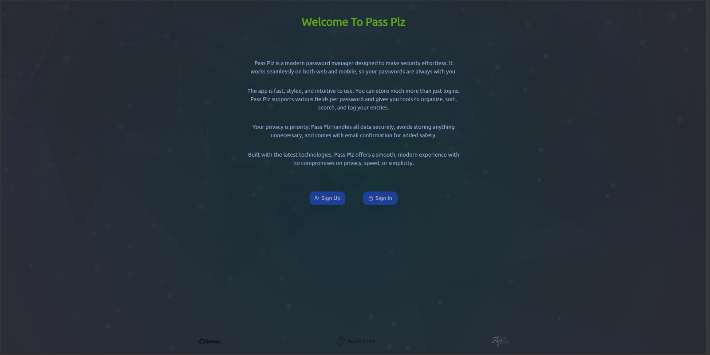
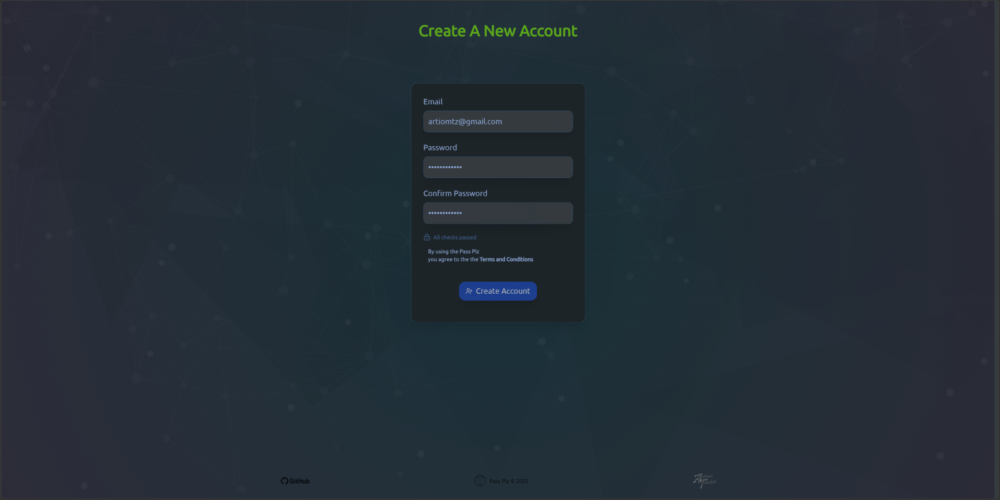
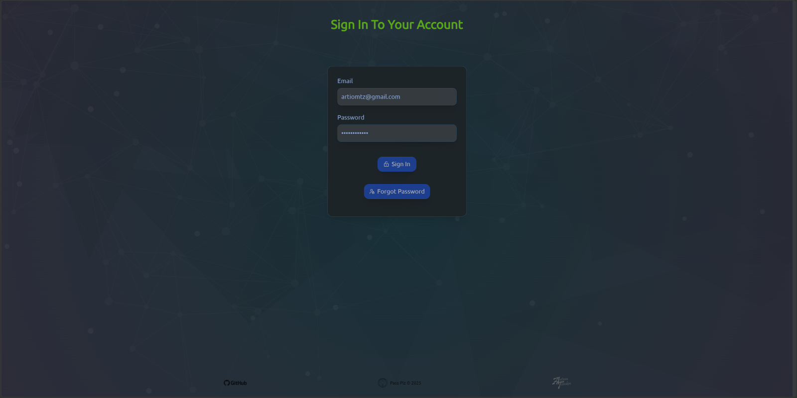
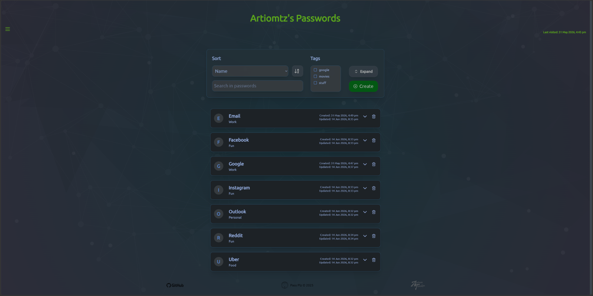
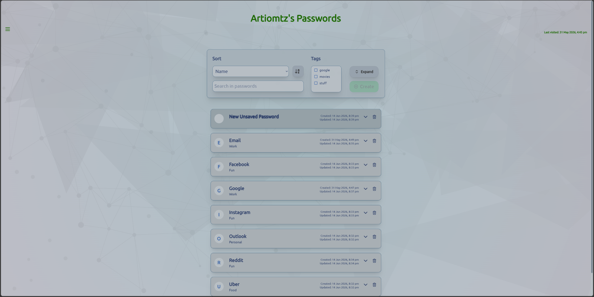
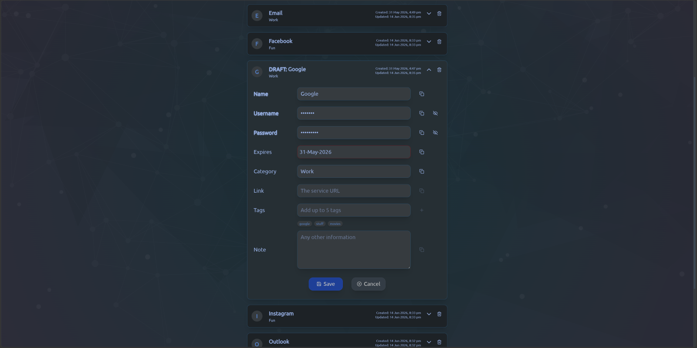
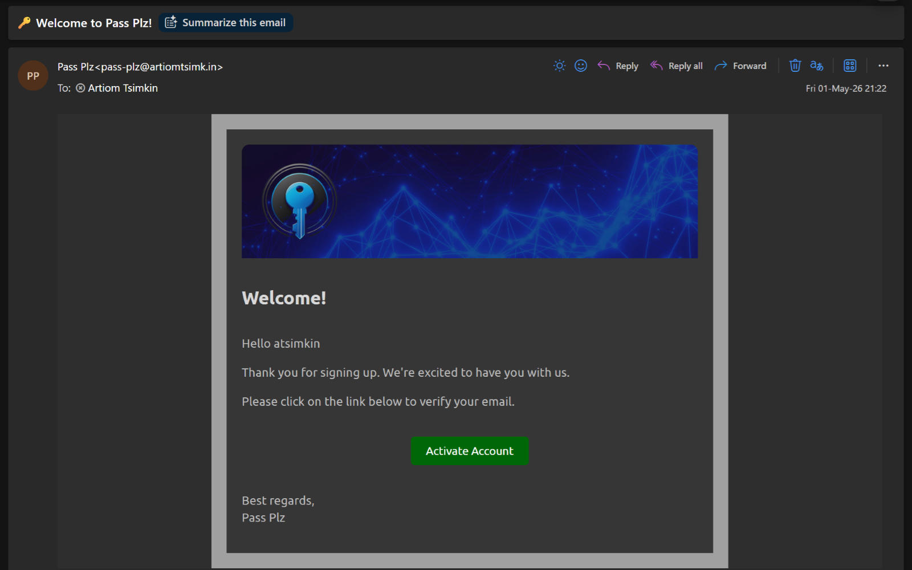
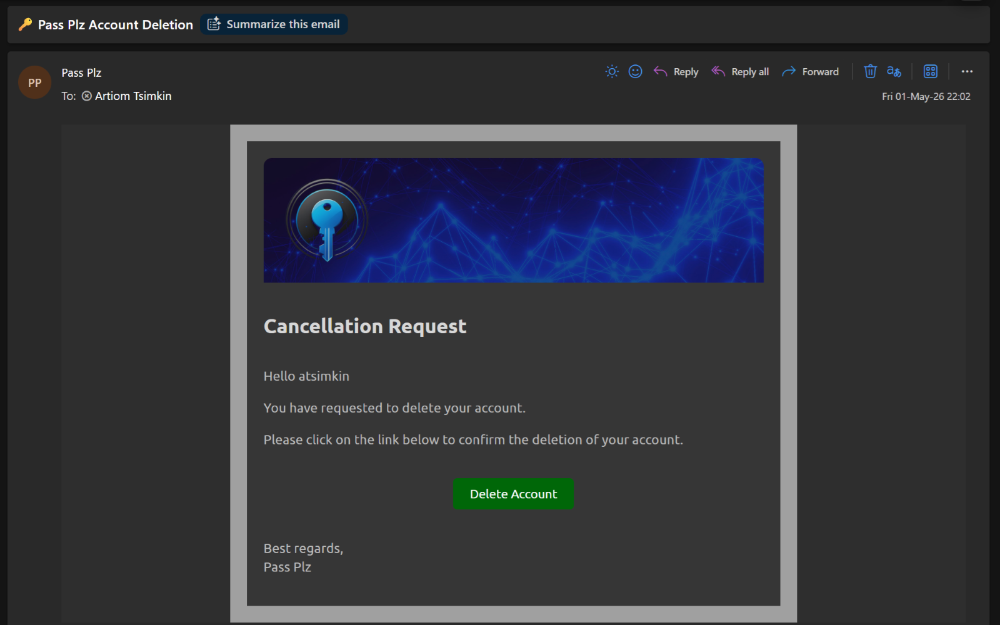
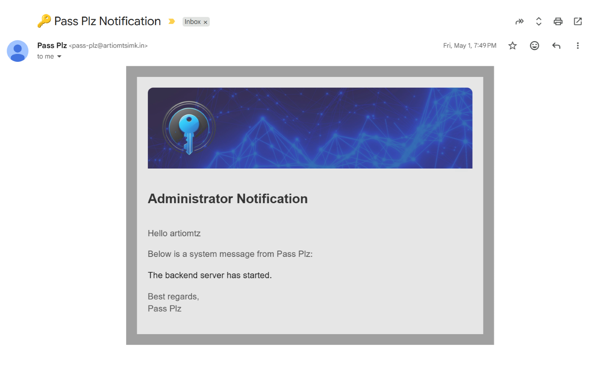

<h1 align="center">Pass Plz</h1>

### Deployment

Available at: [pass-plz.onrender.com](https://pass-plz.onrender.com/)

### Overview

Pass Plz is a modern password manager built for speed, simplicity, and security. It stores and organizes detailed password entries with tags, search, sorting, and multiple field types. The app keeps your data private with minimal storage, secure handling, and email confirmations for added protection. Designed with a clean, intuitive interface, Pass Plz delivers a fast and seamless experience on both web and mobile.

## Front-end

### Stack

- React
- TailwindCSS
- Framer Motion

## Back-end

### Stack

- Spring Boot
- Postmark

## Database

### Stack

- PostgreSQL

## Screenshots

